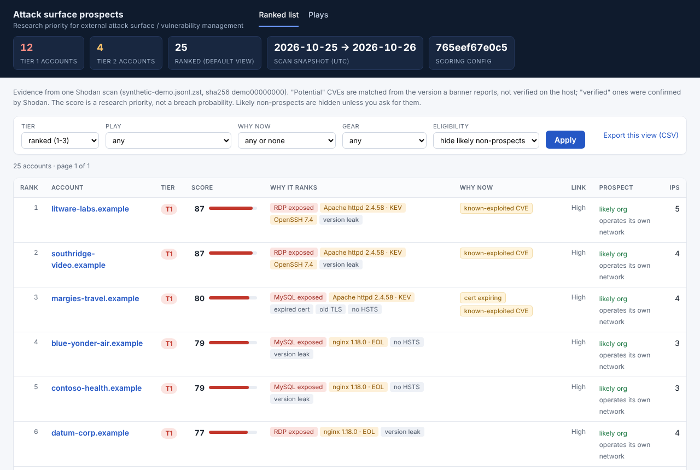
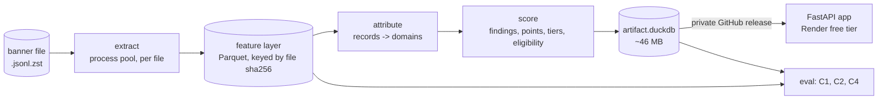

# Sales intelligence from a Shodan banner dump

A small hosted app that helps an SDR at a cybersecurity vendor find, rank and target the
companies most likely to need help with their external attack surface right now, with the
evidence for every point of every score.

- **Hosted app:** https://salesintel-g8b6.onrender.com/ (reviewer credentials provided
  separately; basic auth, noindex). The
  free host sleeps when idle: the first request after a pause downloads the artifact again and
  can take a minute.
- **Brief:** `docs/ASSIGNMENT.md`. Design: `docs/design/`. Every decision with its options and
  reasons: `docs/DECISIONS.md` (D1-D62). Every measured figure: `docs/DATA_NOTES.md` (section 5c).
- Claims are marked **[M]** measured or **[H]** hypothesis, as in the docs.



*Screenshots use a synthetic demo artifact (`.example` domains, documentation IPs); no real
organisation is named in this repository.*

## Contents
1. [Approach](#1-approach)
2. [What the app does](#2-what-the-app-does)
3. [Key decisions](#3-key-decisions)
4. [How we measured whether it works](#4-how-we-measured-whether-it-works)
5. [Scale story](#5-scale-story)
6. [AI in the workflow, and what it cost](#6-ai-in-the-workflow-and-what-it-cost)
7. [Scope cuts and known limitations](#7-scope-cuts-and-known-limitations)
8. [Running it](#8-running-it)

## 1. Approach

**Start from the data, not from a company list.** The file is 14.6M Shodan banners (one record
per scanned IP:port, 123 GB raw, one ~19 h snapshot) [M]. Before any design, a streaming
profiling pass measured schema, fill rates and candidate signals (`docs/DATA_NOTES.md` 1-5). Three
findings shaped everything:

- **It is not a list of companies.** 76% of records sit on cloud / hosting / CDN networks and the
  `org` field is the end business on at most ~5-13% of records [M]. Turning IPs into companies is
  the core problem.
- **Only ~9% of records name a usable domain** (scan hostname, certificate CN, `http.host` or a
  named reverse-DNS entry, after dropping infrastructure names) [M].
- **The obvious signal is a trap.** Shodan's CVE list comes from banner versions. A list of
  2009-2013 Apache CVEs repeats on every Apache banner whatever the version, and CVE-2023-44487
  (HTTP/2 rapid reset, EPSS ~1.0, KEV) sits on 61% of nginx accounts with a version [M]. Sorting by
  "has a critical CVE" largely sorts by "runs nginx or Apache"; on the sample, half of an early
  Tier 2 rested on that one nginx CVE (D49, D50).

**Who it is for.** The SDR building this week's outreach list (D1). We assume the vendor sells
external attack surface / vulnerability management, the only need this data can evidence (D27).
The score is a **research priority**, not a breach probability.

**Pipeline** (offline, local; the app only reads its output):



1. **Extract** streams the zstd file through a process pool, drops CDN edges without a customer
   name, noise modules and honeypots, and writes only the projected fields scoring needs (no
   HTML, no raw banners). Idempotent per file hash, atomic writes, a manifest per run.
2. **Attribute** each kept record to a registrable domain (Public Suffix List incl. the private
   section, D44): **direct** when the record names it (scan hostname > non-wildcard cert CN >
   `http.host` > named PTR, shown as a High / Medium confidence label), **via-IP** (Low) when a
   nameless record (an RDP or database banner, say) sits on a customer IP with exactly one domain.
   Cloud / hosting IPs never get via-IP links: they are shared and re-assigned (D23, D24).
3. **Score** with transparent additive points per finding (D25, `scoring.toml`):

   | Family | Finding | Points |
   |---|---|---|
   | Exposure | Remote access / database / ICS service (RDP, SMB, Telnet, VNC, MySQL, MongoDB, Redis, Modbus, ...) detected by Shodan **module**, never port alone, and not answered by a generic SSH / FTP / HTTP server (D55) | 45 |
   | Software, per product | Potential known-exploited CVE 25, or likely-exploitable CVE (EPSS >= 0.1, CVSS >= 7) 15; end-of-life 15; cap 30 per product, 40 per account | <= 40 |
   | Neglect | Expired cert 5, deprecated TLS 3, self-signed on a public name 3, version disclosed 2, no HSTS 2 | <= 10 |
   | Facts / why-now | Edge appliance (Fortinet, SonicWall, Citrix, ...), login panel, behind a CDN; cert expiring in 30 days, KEV CVE, CVE-2026 ID | 0 (filters, plays, markers) |

   **Tier 1 >= 55** means an observed exposure plus at least one more problem; **Tier 2 40-54** an
   exposure alone or several independent problems; Tier 3 a single patch-lag finding (D50).
   Every finding renders one sentence with its evidence (host, port, module, product and version,
   CVE with CVSS and KEV flag, observed-at), and the breakdown sums to the score.
4. **Prospect eligibility** is a separate rule-based label (likely org / uncertain / likely
   non-prospect: hoster customer servers, ISP zones, dynamic DNS, residential, parked). The
   default view hides likely non-prospects; the label never changes the score (D34, D48).

## 2. What the app does
- **Ranked list** (UC1): score, tier, top reasons, why-now marker, attribution and eligibility
  labels; filters by tier, play, why-now, appliance, eligibility.
- **Account page** (UC2): every finding with its evidence and points, and how each record was
  tied to the domain.
- **Plays** (UC3): exposed services, exploited CVEs, end-of-life software, certificates, edge
  appliances, each with the buyer role to call.
- **CSV export** of the filtered list, the only hand-off (D5).
- Snapshot dates, input file and scoring config version on every page. All record text is escaped;
  no banner HTML is ever rendered.

On the live `data-v2` artifact [M]: 349,520 accounts; default view Tier 1 964, Tier 2 6,165. Page
times 34-156 ms on the full artifact, CSV export of the default view (34 MB) in 1.6 s; server
memory ~230 MB after an export (measured on `data-v1`) with the DuckDB connection capped at
256 MiB (D56), under Render's 512 MB.

## 3. Key decisions
The full log with options and reasons is `docs/DECISIONS.md`. The ones that matter most:

| # | Decision | Why |
|---|---|---|
| D3, D23, D24 | The account is the registrable domain, with a confidence label per link; three infrastructure classes (CDN dropped, cloud / hosting direct-only, customer network via-IP allowed) | `org` is rarely the customer; via-IP on shared infrastructure would hand a host's RDP to every tenant |
| D25 | Additive points with caps, not a model | No labels to train on; every point must be explainable to the prospect |
| D26, D47, D49 | Down-weight **version-independent** CVEs (a CVE that matches >= 90% of a product's versions only says "runs Apache"), not merely common ones | A share-of-accounts cut-off would also hide real patch lag; CVE-2023-44487 is version-dependent and stays scored |
| D35 | CVEs from banner matching are labelled **"potential"**; "verified" only when Shodan verified it | Openers must be true |
| D34 | Eligibility is a filter beside the score, not a factor in it | Being a hoster does not make a host less exposed; it makes it a worse prospect |
| D8, D43 | Develop on a **domain-complete** sample (stable-hash 5% of domains, every record of their IPs, the IP's full domain count carried) | A line sample splits accounts; carried counts keep shared IPs shared |
| D28, D37, D50 | Tune once on the sample, **freeze weights before labelling**, then evaluate | Labels taken after tuning measure the tuning |
| D20 | The artifact is never in git; private release asset, downloaded at startup with a read-only token | It is a list of vulnerable organisations (NFR5) |
| D51, D56 | Bounded memory: scoring streams from Parquet with a 6 GB DuckDB limit; app connection capped at 256 MiB | Full-file scoring peaked at 13.5 GB before, 2.7 GB after [M] |
| D55 | Count an exposure only when the answering product is not a generic SSH / FTP / HTTP server, applied **after** C2 as a new config version | The module names the probe, not always the service that answered |

## 4. How we measured whether it works
Four questions, each with a script under `src/salesintel/eval/` and results in DATA_NOTES 5c.

### C1. Do the IP-to-domain links hold? (forward DNS)
Automated: for 300 links per source, does the domain or hostname resolve to the record's IP today?
A match supports a link; it does not prove ownership (D39). Full file [M]:

| Source | Label | Match rate |
|---|---|---|
| `http.host` | Medium | 0.937 |
| scan hostname | High | 0.807 |
| reverse DNS (PTR) | Medium | 0.587 |
| certificate CN | High | 0.417 |
| via-IP | Low | 0.173 |

Via-IP is the weakest link, as its Low label says. **Open question:** certificate-CN links are
labelled High but match DNS less often than both Medium sources. Hypothesis [H]: the certificate
names the bare domain while the host is a mail or VPN server on another IP. The labels stay until
the hand-check of the misses is done.

### C4. Is the ranking knife-edge? (sensitivity)
Each of the 10 point weights moved +/-25% on the sample (+/-1 point for the 2-point weights, which
round back otherwise, D54) [M]: **top-20 overlap >= 0.85 in all 20 runs, Spearman over all
accounts >= 0.9971.** The order does not hinge on any single weight.

### C2. Does the ranking beat a simpler sort? (blind labels)
Weights frozen first (config `765eef67e0c5`, release `data-v1`). Pool: our top 20, the top 20 by
highest CVSS, and 20 random accounts from the same default-eligible set, shuffled and shown blind
with neutral evidence. The question per account: would an SDR call this account with this
evidence? (`worth_a_call`). Our top 20 and the highest-CVSS top 20 share **no** accounts [M].

**Run 1, human rater, evidence v1** [M]:

| Ranking | precision@20 | Wilson 95% |
|---|---|---|
| Highest CVSS first | 1.00 | 0.83-1.00 |
| Ours | 0.84 | 0.62-0.95 |
| Random | 0.21 | 0.09-0.43 |

**Its flaw, found after labelling:** the sheet showed each account's first 12 records ordered by
IP. Our 4 no / unknown accounts have 34-1,488 IPs, and in all 4 the records that earned the score
(exposed RDP / MySQL / DNP3 plus known-exploited software) fell outside those 12 lines, so the
rater saw no CVE and no risky service. The highest-CVSS list is almost all single-IP accounts,
whose evidence always fits. A harness bias against large accounts. Run 1 stays on record as
measured; the sheet was fixed (evidence v2, worst-first by a rule independent of our weights, D59).

**Run 2, AI rater, evidence v2** [M]. Human labelling stopped after 45 of 60 rows (D60, a time cut),
so run 2 is an LLM rater on all 60 rows (NVIDIA `nemotron-3-ultra-550b-a55b`, thinking off,
temperature 0, structured output), checked against the human labels:

| Ranking | precision@20 (AI rater) | Wilson 95% |
|---|---|---|
| Highest CVSS first | 0.800 | 0.584-0.919 |
| Ours | 0.789 | 0.567-0.915 |
| Random | 0.105 | 0.029-0.314 |

Human vs AI on `worth_a_call` over the 45 human-labelled rows: **75.6% agreement, Cohen's kappa
0.551** (moderate). The AI is stricter: it never said yes where the human said no, and turned 7
of the human's 28 yes into no.

**What C2 says.** Both rankings are far above random. Ours does **not** beat "highest CVSS first"
on this question: it ties within the intervals (run 2) or trails (run 1, with the harness flaw).
The two lists find disjoint accounts of similar callability [M]; ours reaches accounts a CVSS sort
does not surface, such as observed exposures and large multi-IP estates [H, from the run-1
diagnosis, not measured separately]. We report the result as it
came out rather than re-tuning against it.

**Caveats on run 2, stated plainly:**
- Its precision is the AI rater's, not a human measurement.
- The AI's credibility rests on agreement over 45 rows, which leave out 15 of the 20 rows that run
  1 had truncated (the ones the human did not relabel).
- The 5 relabelled reset rows the human did label had been seen once in run 1 (with cut-off
  evidence), so those labels are not fully blind.
- The AI cannot look a domain up; the human could.

**A finding about the rater itself** [M]: the first AI attempt left 8 of 15 rows invalid because a
reasoning model spent its 1,000-token budget thinking before writing the JSON. On one test row,
the provider's `enable_thinking: false` switch cut the same model from 810 to 290 output tokens
(17.5 s to 9.7 s), while the commonly suggested `/no_think` prompt tag did not reliably switch
thinking off (a smaller model hit 4,000 tokens and was cut off). The rater now has a token budget,
logs each row's finish reason, and runs with thinking off (D61, D62). The full run: 60/60 valid, 0
refusals, every finish reason `stop`.

### D55: a false-evidence bug, measured and fixed after the evaluation
While checking the UI we found exposures whose answering service was something else: Shodan's
`rdp` probe answered by OpenSSH, `telnet` by OpenSSH, `mysql` by nginx. The module names the probe
that ran, not always the service that answered. Fixed only **after** C2, as a new config
(`6bacfc84480b`, weights unchanged), so the evaluation measured the frozen ranking [M]:

- Our C2 top 20 (run 1): **1 of 20** had a false exposure, and its awarded exposure points were the
  false ones. Highest CVSS 0/20, random 0/20.
- Whole artifact: 135 of 9,899 exposed-service findings were another service (1.4%): OpenSSH 62,
  nginx 45, Ncat proxy 20, others 8.
- Rescored as `data-v2` (now live): Tier 1 1,691 -> 1,666 and Tier 2 7,535 -> 7,493 over all
  accounts; 19 accounts moved Tier 1 -> 3, 6 Tier 1 -> 2, 8 Tier 2 -> 3, 40 Tier 2 -> not ranked;
  none moved up. Default view Tier 1 982 -> 964; default-view top-20 overlap 19/20.

## 5. Scale story
The brief says hundreds to thousands of files like this arrive every month. Measured on one file
on the owner's 8-core machine [M]:

| Step | Wall time | Peak memory | Output |
|---|---|---|---|
| Extract (7 workers) | 9 min 07 s (~26.7k records/s) | ~0.5 GB | feature layer 1.03 GB (0.84% of raw) |
| Score (full feature layer) | 1 min 22 s | 2.7 GB | artifact 45.9 MB |
| App on the artifact | 34-156 ms per page | ~230 MB | |

What that implies [H, arithmetic on the measured figures]: extraction is the cost, ~9 minutes of
an 8-core machine per file, so 1,000 files a month is ~150 machine-hours, and files are
independent, so it scales out per file. Re-scoring never touches raw (weights and rules change
only the score step). Storage is the real cost: ~17.6 TB of compressed raw per 1,000 files, which
is why raw goes to cold storage for N days and the 1 GB-per-file feature layer is what is kept
(D9, D10).

What changes in production, designed but not built (`docs/design/architecture.md`): stateless
extract workers fed by a queue of file hashes; feature partitions in object storage; and a
**coverage-aware merge before attribution**, because an IP's certificate and its RDP banner can
arrive in different files. A finding is new, still present, resolved (the same IP:port was
scanned and it is gone) or not observed (not scanned): missing never means fixed (D11, D40). That
merge is also what gives the strongest why-now signal, "new since last scan", which one file
cannot show and which we did not fake.

## 6. AI in the workflow, and what it cost
- **Understanding the data came first, without an LLM reading it.** The profile in DATA_NOTES was
  built from aggregate scripts over the full file. Raw records, HTML and banners were never pasted
  into a model; record contents are treated as untrusted and never rendered.
- **A coding agent did most of the typing, under explicit rules.** Design was worked through one
  step at a time (use cases, requirements, signals and scoring, architecture, MVP) with the agent
  recommending and the owner deciding; every decision went into `docs/DECISIONS.md` with the
  options that lost. The agent worked on a 1-in-160 line sample and the domain-complete sample;
  full-file runs happened on the owner's machine and came back as measured figures. Two external
  reviews of the design were triaged item by item into decisions (D23-D41). The coding agent's own
  usage cost was not tracked.
- **Measuring the AI that is in the product's evaluation.** No LLM is in scoring. The one LLM in the
  loop is the C2 second rater (section 4): its agreement with the human is reported (kappa 0.551),
  and so is its cost: 55,127 input / 12,631 output tokens for 60 accounts, **$0.063 at the list
  price** ($0.60 / $2.40 per M tokens), $0 as run on NVIDIA's free tier. Evidence is passed as
  delimited untrusted data, and a test feeds it an injection attempt.
- **Where the agent was wrong, and how it was caught.** The C2 harness flaw (run 1), the false
  exposures (D55) and a scoring run that needed 13.5 GB (D51) were all found by checking outputs
  against the data, not by trusting the code; each became a recorded decision and a test.

## 7. Scope cuts and known limitations

**Cut, with reasons** (`docs/design/mvp.md`):

| Cut | Reason |
|---|---|
| Multi-file merge (FR11), "what's new" (UC4), C5 | One file; designed in `architecture.md` |
| Queue, workers, object storage, raw retention | Design only; the same extract code runs on a local process pool |
| LLM account / industry classifier | Rules cover eligibility; the only LLM is the C2 rater (D57) |
| C3 (KEV lift) and a most-CVEs baseline | Cut in review to fit the label budget |
| Country / territory filter | Not in the brief; IP geography is skewed by CDN edges (D29) |
| "Recently went end-of-life" | The file has no EOL dates (D2) |
| CRM push, enrichment, contacts, outreach drafting | Outside the brief, or called not the interesting part (D5) |
| Human labels for C2 run 2 | Time (D60); run 2 uses the AI rater, see the caveats |

**Known limitations:**
- **72% of accounts are "uncertain"** on prospect eligibility. The label hides the obvious
  non-prospects (hosters, ISP zones, dynamic DNS, residential, parked) and does not classify the
  rest.
- **End-of-life play shortcut:** it matches "end-of-life" in the finding sentence, because the
  artifact has no separate EOL flag.
- **Certificate-CN links** are labelled High but matched DNS less often than Medium sources (C1,
  open question).
- **CVEs are potential**, from banner-version matching; backported patches make some false.
- **C2 is small:** 20 accounts per list, wide intervals, one human rater, and run 2 rests on the
  AI rater with the caveats above.
- **One ~19 h snapshot:** no history, so no "new since last scan".
- The free host sleeps; the first request after idle re-downloads the artifact.

## 8. Running it
Python 3.13 with [uv](https://docs.astral.sh/uv/). The banner file and every generated
`*.duckdb` / `*.parquet` stay out of git.

```bash
uv sync --extra pipeline                     # add --extra llm for the AI rater
uv run pytest -q                             # 121 tests

# pipeline (full file: run locally; see DATA_NOTES 5c for times)
uv run salesintel-extract dataset.json.zst --out out/full
uv run salesintel-score out/full/features/<sha256> --out out/full/artifact.duckdb

# evaluation
uv run salesintel-dnscheck out/full/features/<sha256> --out out/full/c1              # C1
# C4 on the domain-complete sample (modulus 20)
uv run salesintel-sensitivity <sample features dir> --out out/c4.json --sample-modulus 20
# C2 run 2, as run (LLM_API_KEY in the environment)
uv run salesintel-labelpool build out/full/artifact.duckdb out/full/features/<sha256> --out out/full/c2v2 --from out/full/c2
LLM_BASE_URL=https://integrate.api.nvidia.com/v1 uv run salesintel-labelpool ai-label out/full/c2v2 --provider openai --model nvidia/nemotron-3-ultra-550b-a55b --no-thinking --price-in 0.60 --price-out 2.40
uv run salesintel-labelpool evaluate out/full/c2v2 --rater ai

# app on a local artifact
APP_USERNAME=demo APP_PASSWORD=demo ARTIFACT_PATH=out/full/artifact.duckdb \
  uv run uvicorn salesintel.app.main:create_app --factory
```

`uv run python scripts/demo_artifact.py` builds the synthetic artifact used for the screenshots.
Deployment: `render.yaml` and `Dockerfile`; on Render the app downloads the artifact named by
`ARTIFACT_REPO` / `ARTIFACT_TAG` / `ARTIFACT_NAME` with a read-only `GITHUB_TOKEN` (currently
`data-v2`).
