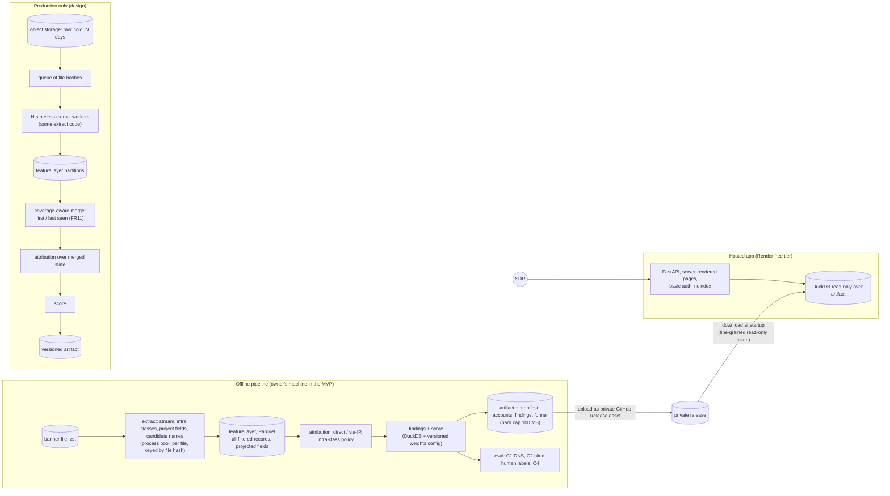

# Architecture

Status: agreed 2026-10-27, revised the same day after external review. Decisions D19-D20,
D24, D30-D32, D40 in `docs/DECISIONS.md` (D9-D11 also apply).
**[M]** measured, **[H]** hypothesis.

## Overview
Heavy work is offline; the hosted app only reads a small precomputed artifact.

## Offline pipeline
1. **Extract** (per file, parallel, idempotent by file content hash; D9). Stream zstd lines, parse,
   apply the infrastructure-class policy, project fields, compute name candidates
   (`signals-scoring.md` section 1; the same policy as FR7).
   - Dropped: `honeypot` tag; noise modules; shared CDN / WAF edge records that do not name a
     non-infra domain themselves.
   - Kept: all other records, including nameless ones (they may attribute via-IP), with the
     projected fields in the feature schema (`signals-scoring.md` section 3). No `http.html`, no
     raw `data`.
   - Size vs raw: [H] much smaller; measured on Wednesday.
2. **Attribution**: direct vs via-IP per record; via-IP only for single-domain, non-CDN,
   non-cloud/hosting IPs; everything else unresolved and counted in the funnel.
3. **Findings + score**: DuckDB SQL plus a small Python rule layer, driven by a versioned weights
   config (FR8). Writes the artifact and the funnel (FR9).
   - **Manifest** with every output (NFR7): input file hash, extractor version, blocklist version,
     PSL snapshot version, scoring config version, code commit, row counts.
   - **Atomic writes**: write to a temp file in the same directory, fsync, rename; a crashed run
     never leaves a half-written partition or artifact.
   - **Publish** refuses an artifact over the 100 MB hard cap (NFR3).
4. **Eval** (FR10): C1, C2, C4 from `signals-scoring.md` section 4, from one command.

## Hosted app
- FastAPI with server-rendered HTML tables; DuckDB in-process, read-only over the artifact.
- Pages: ranked list with filters and plays (FR1, FR2a, FR4), account detail (FR3), CSV export
  (FR5), snapshot date and source on every page (FR6).
- Basic auth on every route; credentials in Render env vars, given only in the submission note
  (D12). `X-Robots-Tag: noindex` on every response. All record-derived text escaped (NFR5).
- **Artifact delivery (D20).** The artifact is never in git. It is an asset on a private GitHub
  Release of this (private) repo. At startup the app downloads it with a fine-grained, read-only
  token for this repo only, kept in Render env vars. Render's free disk is ephemeral, so every
  cold start re-downloads it; the README says so.

## Scaling: what the MVP builds vs the design

| Concern | MVP (one file) | Production (hundreds-thousands of files / month) |
|---|---|---|
| Extract | Local process pool: full file in 9 min 07 s on 8 cores / 7 workers (~26.7k records/s, peak RSS ~0.5 GB), feature layer 1.03 GB [M] | Same function on N stateless workers fed by a queue of file hashes; files are independent, so workers scale out per file |
| Raw storage | Owner's disk | Cold object storage for N days, then deleted (D10) |
| Feature layer | Local Parquet | Partitioned Parquet in object storage, one partition per file hash |
| Order of steps | extract -> attribution -> score (merge is trivial with one file) | extract -> **merge -> attribution -> score**. Attribution must run on merged state: an IP's cert and its RDP banner can arrive in different files |
| Merge | n/a | Coverage-aware, `first_seen` / `last_seen`; see "FR11 merge invariants" below |
| Query engine | DuckDB on one machine | DuckDB while the merged state fits one node [H]; the same SQL moves to a warehouse beyond that |
| App data | One artifact per run | Versioned artifact per scoring run; app switches on restart |
| Re-scoring | Re-run score on the feature layer | Same; only new extractors need raw (within N days) |

## FR11 merge invariants (design only)
Findings are keyed by (account, finding type, product + version or service, IP:port). Merging a
file is idempotent (a file hash already merged is a no-op) and order-independent (state is
derived from scan timestamps, not arrival order), so `first_seen` never moves later and
`last_seen` never moves earlier. On each merged file a finding is **new** (first observation),
**still present**, **resolved** only after a comparable re-probe (same IP:port, same module, a
banner was returned, and the finding is absent), or otherwise **not observed**; missing never
means fixed. Attribution re-runs on the merged state, so a finding follows its IP to whichever
account the merged evidence supports, and every state change keeps the file hash that caused it.
