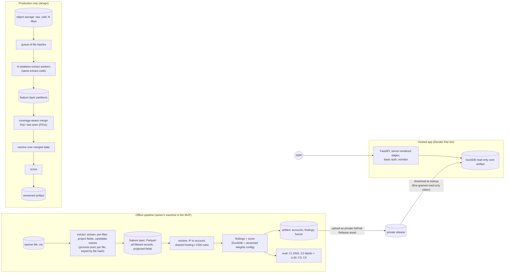

# Architecture

Status: agreed 2026-10-27. Decisions D19-D20 in `docs/DECISIONS.md` (D9-D11 also apply).
**[M]** measured, **[H]** hypothesis.

## Overview
Heavy work is offline; the hosted app only reads a small precomputed artifact.

## Offline pipeline
1. **Extract** (per file, parallel, idempotent by file content hash; D9). Stream zstd lines, parse,
   pre-filter, project fields, compute candidate names per record (signals-scoring 1, pass 1).
   - Pre-filter drops: `honeypot` tag; noise modules; CDN / WAF edge records with **no** non-infra
     candidate name. Edge IPs are shared, so they are never assigned to an account by IP and
     such records can never join one.
   - The feature layer keeps **all other filtered records**, including nameless ones: they join
     accounts through their IP in resolve. Projected fields only (no `http.html`, no raw `data`):
     IP, port, transport, timestamp, module, org / ASN / country, tags, candidate names and their
     sources, product / version / CPE, CVE IDs with CVSS / EPSS / KEV / ransomware, cert dates /
     self-signed / CN / `O`, TLS versions, security-header flags, filtered title, WAF.
   - Size vs raw: [H] much smaller (no html / data, which dominate the 8.4 KB average record).
     Measured on Wednesday on the domain-complete sample and the line sample.
2. **Resolve** (pass 2): IP -> account with shared-hosting and CDN rules, confidence labels.
3. **Findings + score**: DuckDB SQL plus a small Python rule layer, driven by a versioned weights
   config (FR8). Writes the artifact and the funnel (FR9), stamped with file hash, code and config
   version (NFR7).
4. **Eval** (FR10): C1-C4 from `signals-scoring.md` section 3, from one command.

## Hosted app
- FastAPI with server-rendered HTML tables; DuckDB in-process, read-only over the artifact.
- Pages: ranked list with filters and plays (FR1, FR2a, FR4), account detail (FR3), CSV export
  (FR5), snapshot date and source on every page (FR6).
- Basic auth on every route; credentials in Render env vars, given only in the submission note
  (D12). `X-Robots-Tag: noindex` on every response. All record-derived text escaped (NFR5).
- **Artifact delivery (D20).** The artifact is never in git. It is an asset on a private GitHub
  Release of this (private) repo. At startup the app downloads it with a fine-grained, read-only
  token for this repo only, kept in Render env vars. Render's free disk is ephemeral, so every
  cold start re-downloads it; the README says so.

## Scaling: what the MVP builds vs the design
| Concern | MVP (one file) | Production (hundreds-thousands of files / month) |
|---|---|---|
| Extract | Local process pool, 7 workers, ~13 min per file [M] | Same function on N stateless workers fed by a queue of file hashes; linear (~210 machine-hours per 1,000 files [M-derived]) |
| Raw storage | Owner's disk | Cold object storage for N days, then deleted (D10) |
| Feature layer | Local Parquet | Partitioned Parquet in object storage, one partition per file hash |
| Order of steps | extract -> resolve -> score (merge is trivial with one file) | extract -> **merge -> resolve -> score**. Resolve must run on merged state: an IP's cert and its RDP banner can arrive in different files |
| Merge | n/a | Coverage-aware: new / still present / resolved / not observed, `first_seen` / `last_seen` (FR11, D11) |
| Query engine | DuckDB on one machine | DuckDB while the merged state fits one node [H]; the same SQL moves to a warehouse beyond that |
| App data | One artifact per run | Versioned artifact per scoring run; app switches on restart |
| Re-scoring | Re-run score on the feature layer | Same; only new extractors need raw (within N days) |
